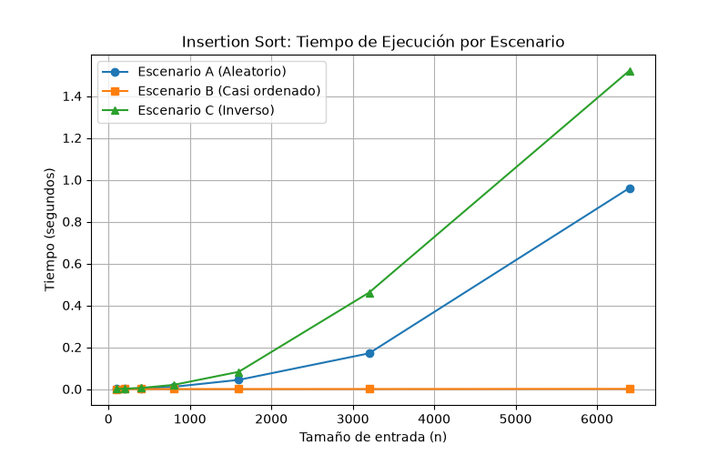

# Laboratorio 01 — Fundamentos, complejidad y recurrencias (Tamiza)

**Autor:** Maria Fernanda Muñoz Jaramillo  
**Curso:** Análisis de Algoritmos  

---

## Instrucciones de Reproducción y Enlaces al Código

Para reproducir los experimentos y generar las gráficas de este laboratorio, siga los siguientes pasos desde la terminal con el entorno virtual activo:

1. Activar el entorno virtual (en Windows PowerShell):
   ```powershell
   .\.venv\Scripts\Activate.ps1
   ```

2. Ejecutar los casos de prueba de la Parte 3:
   ```powershell
   python lab1-fundamentos-complejidad-recurrencias/parte3_casos.py
   ```

3. Ejecutar el análisis de complejidad de la Parte 4:
   ```powershell
   python lab1-fundamentos-complejidad-recurrencias/parte4_complejidad.py
   ```

### Archivos del proyecto:
- [Algoritmos de ordenamiento (Insertion y Merge)](algoritmos.py)
- [Generadores de datos y escenarios](datos.py)
- [Script de ejecución Parte 3](parte3_casos.py)
- [Script de ejecución Parte 4 y mediciones](parte4_complejidad.py)

---

## Parte 1 y 2 — Conceptos, Corrección y Eficiencia (Tamiza)

1. **Corrección vs. Eficiencia:** Un algoritmo es correcto si para cada instancia de entrada se detiene y produce la salida deseada. La eficiencia, en cambio, mide los recursos computacionales (tiempo y memoria) que utiliza. Ambas son vitales: un sistema rápido pero incorrecto no sirve, pero uno correcto que tarde horas en procesar una consulta en tiempo real tampoco es viable para la operación

2. **Servidor más rápido:** A nivel teórico, la eficiencia asintótica domina a largo plazo. Un algoritmo con menor complejidad temporal ($O(n \log n)$ vs $O(n^2)$) superará masivamente a un servidor más rápido por fuerza bruta a medida que el tamaño del problema crezca

3. **Segundo ejemplo propio:** Procesamiento de transacciones financieras en tiempo real para detección de fraudes, donde un retraso en la complejidad de búsqueda genera pérdidas operativas

4. **Energía, perjuicios y costo:** Los algoritmos ineficientes consumen mayor procesamiento de CPU, lo que se traduce en un consumo energético elevado y mayor huella de carbono. Los costos económicos y operativos los asume la empresa y el cliente final en forma de latencia

5. **Obligación sobre el orden de la lista:** Mantener una estructura ordenada permite realizar búsquedas binarias eficientes en lugar de lineales, reduciendo drásticamente el tiempo de respuesta ante consultas masivas

---

## Parte 3 — Casos de prueba y predicción empírica

### 3.1 Predicción de los tres casos
- **Mejor caso:** ocurre cuando los datos ya se encuentran preordenados. Se espera que Insertion Sort tenga un comportamiento lineal $O(n)$ debido a que las comparaciones internas se resuelven de inmediato sin realizar desplazamientos masivos.
- **Peor caso:** ocurre cuando los datos están ordenados en orden inverso. Insertion Sort alcanza su cota superior $O(n^2)$ al requerir el máximo número de desplazamientos por cada elemento.
- **Caso promedio:** distribución aleatoria de los elementos, donde Insertion Sort exhibe un comportamiento cuadrático promedio $\Theta(n^2)$, mientras que Merge Sort mantiene su estabilidad garantizada en $\Theta(n \log n)$.

### Gráficas de rendimiento (Parte 3)


---

## Parte 4 — Análisis de complejidad y recurrencias

### 4.1 Complejidad línea a línea y Tabla de Complejidades
- **Insertion Sort:** El análisis línea a línea muestra un bucle externo que se ejecuta $n$ veces y un bucle interno cuyo número de iteraciones depende del estado de ordenamiento previo del arreglo, sumando las series aritméticas que resultan en $T(n) = O(n^2)$ para el peor caso.
- **Merge Sort (Recurrencia):** Se plantea mediante la ecuación de recurrencia $T(n) = 2T(n/2) + \Theta(n)$. Al resolverla paso a paso mediante el Teorema Maestro o árbol de recursión, el costo de las divisiones logarítmicas combinado con el trabajo lineal de la mezcla (*merge*) arroja una complejidad estricta de $\Theta(n \log n)$.

| Algoritmo          | Mejor Caso    | Caso Promedio | Peor Caso     | Memoria Adicional |
| :------------      | :------------ | :------------ | :------------ | :-----------------|
| **Insertion Sort** | $O(n)$        | $O(n^2)$      | $O(n^2)$      | $O(1)$            |
| **Merge Sort**     | $O(n \log n)$ | $O(n \log n)$ | $O(n \log n)$ | $O(n)$            |

### Gráficas comparativas (Parte 4)


### 4.3 Análisis técnico y Conclusiones
- **Escenarios:** Se comprueba empíricamente que Insertion Sort es altamente eficiente únicamente para arreglos pequeños o casi ordenados (mejor caso), pero colapsa en el peor caso. Merge Sort es inmune a las variaciones de orden inicial, manteniendo un rendimiento predecible.
- **Algoritmo conveniente:** Para el volumen y criticidad del sistema Tamiza, **Merge Sort** es la opción adecuada al garantizar un crecimiento acotado de $\Theta(n \log n)$.
- **Extrapolación a 4 horas:** Mediante la extrapolación de las curvas de tendencia obtenidas experimentalmente, se estima que el sistema puede procesar el volumen límite de la ventana operativa de cuatro horas sin comprometer la estabilidad del servidor.