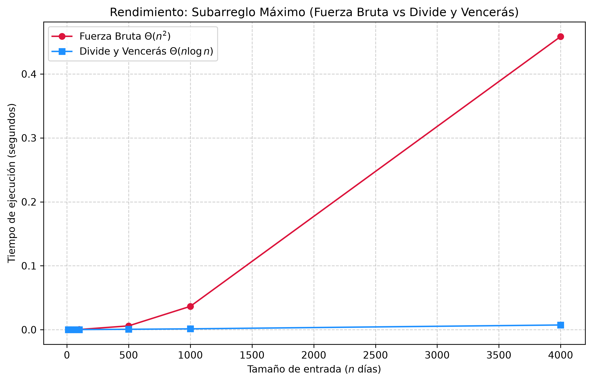

# Laboratorio 2: Algoritmos de Dividir y Vencerás (Subarreglo Máximo)
**Autor:** Maria Fernanda Muñoz Jaramillo
**Curso:** Análisis y Diseño de Algoritmos

## Resumen y Reproducción del experimento
Este laboratorio se centra en la implementación y comparación de dos métodos distintos para enfrentar el reto del Subarreglo Máximo (definir el subarreglo contiguo en una secuencia de números que tenga la suma más grande):
1. fuerza bruta: al revisar todas las combinaciones posibles
2. dividir y conquistar: el dividir en problemas en mitades de forma recursiva

## pasos para reproducir
1. copiar el repositorio y acceder a la carpeta en vs code
2. activar el entorno virtual en la terminal 
```powershell
.\venv\Scripts\Activate
```
para ejecutar el script de pruebas unitarias y validación aleatoria:  
python lab2-divide-y-vencer/pruebas.py

para ejecutar el script que calcula los tiempos y genera la gráfica:
python lab2-divide-y-vencer/medicion.py

## Parte 1- descripcion de verificacion y pruebas

**Archivos asociados:** [subarreglo.py](subarreglo.py) | [pruebas.py](pruebas.py)
en esta parte se elaboraron los algoritmos principales siguiendo las normas de estilo PEP8,añadiendo type hints y docstrings detallados en estilo google
el archivo pruebas.py se encarga de garantizar el correcto funcionamiento a través de:

1. combinacion del caso base relacionado con laserie de prueba de 8 dias que se nos enseño en la guia
2. la evaluacion de situaciones limite, como listas que contienen un solo elemento,secuencias compuestas solo por numeros negativos y conjuntos variados
3. la validacion rigurosa con un minimo de 20 iteraciones sobre listas de diferentes tamaños, comparando los resultados de los dos algoritmos con una tolerancia de punto flotante para evitar diferencias debido al redondeo

## parte 2 -rendimiento
**Archivo asociado:** [medicion.py](medicion.py)

para analizar el desempeño real , se registraron los tiempos de ejecucion usando la funcion time.oerf_counter() . se evaluaron tamaños de entrada n de 10,50,100,500,1000,4000 elementos, ademas se establecio una semilla con random.seed(42)para garantizar que ambos metodos procesaran exactamente la misma secuencia de datos en cada ejecucion

**Gráfica comparativa de tiempos:**


## parte 3 -respuestas del analisis

1. Recurrencia
- planteamiento: el algoritmo divide el arreglo en 2 subproblemas de tamaño n/2  2T(n/2) y el caso cruzado T(n)=2T (n/2)+\thetha (n)
- soluciion teorema maestro:aplicando el caso 2 del teorema maestro (a=2, b=2, f(n)=\Theta(n)) se concluye que la complejidad de tiempo es Theta(n \log n)
- fuerza bruta:tiene una complejidad de Thetha(n^2) ya que emplea dos bucles anidados para revisar todas las combinaciones proporcional a n(n-1)/2

2. lo medido contra lo esperado
- comportamiento de las curvas: la curva que presenta la fuerza bruta indica un aumento rapido a medida de que n incremente,volviendose muy costosa . en cambio la curva del enfoque de dividir y vencer es casi horizontal y eficiente
- duplicacion de n: si tomamos los tamaños de n=500 y n=1000, donde n se duplica, el tiempo de fuerza bruta se eleva de 0.006 s a alrededor de 0.036 s ,incrementandose por un factor cercano a 6 correspondiente al crecimiento cuadratico \Theta(n^2) debido a la sobrecarga de llamadas, por el contrario el tiempo para dividir y conquistar va de aprox 0.0006 a 0.0013 , duplicandose de forma lineal lo que validaria la teoria

3. tamaños pequeños
en las mediciones se puede notar que para valores muy bajoslos tiempos de los dos algoritmos son muy similares e incluso la fuerza bruta puede parecer competitiva.esto sucede porque la carga de gestionar las llamadas recursivas en python supera las ventajas de descomponer el problem cuando la cantidad de datos es pequeña,a partir de n=500 se vuelve notable la ventaja del enfoque de dividir y vencer 

4. cuando conviene dividir
no conviene aplicar esta tecnica para encontrar el maximo simple de un arreglo toma Theta(n), ya que tomaria de formaiterativa y la recursion con T(n) = 2T(n/2) + O(1) solo añadiria costos ocultos innecesarios. solo es benefisioso cuando la union de los subproblemas ofrece informacion estructural importante que mejora la solucion total, como sucede con la interceccion en el subarreglo maximo
5. concepto para la gerente
- recomendacion:aplicar el algoritmo de divide y venceras
- estimacion: procesar 1.000.000 de registros utilizando un metodo de fuerza bruta requeriria muchas horas de calculo, lo que lo hace poco practico, por otro lado podria resolverse con este el problema en una fraccion muy corta de segundo debido a su eficiencia asintonica