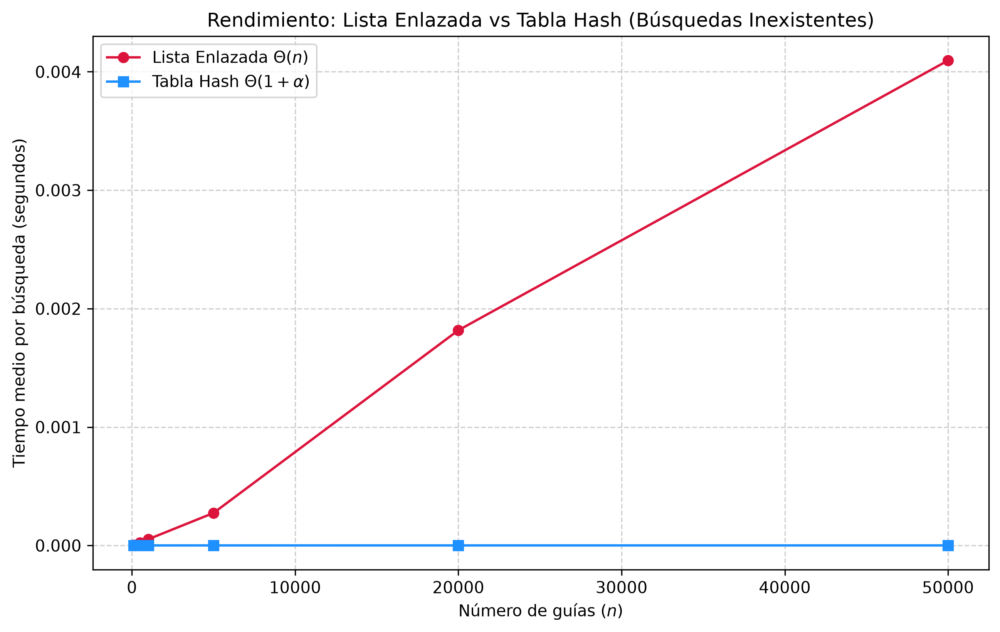
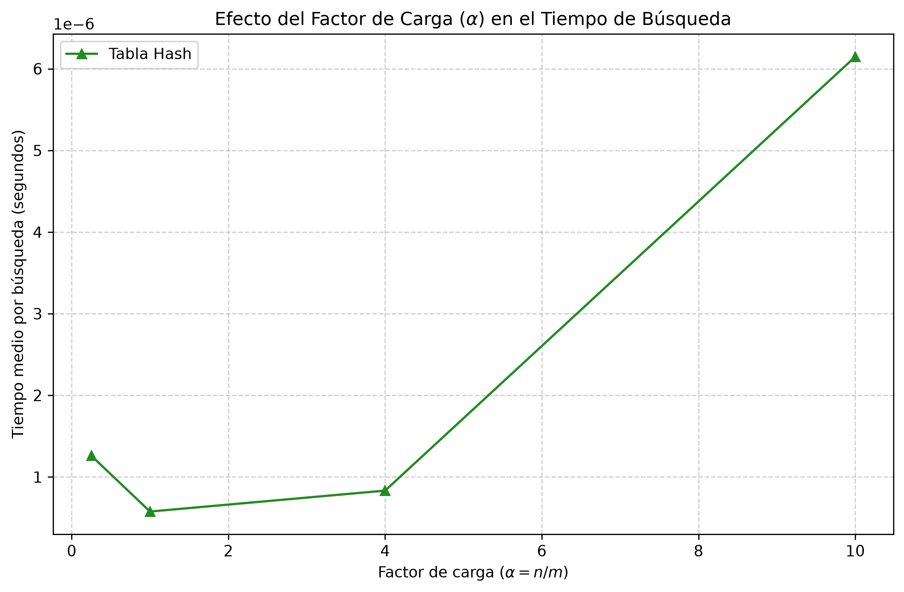

# Laboratorio 3: Estructuras de datos (Rutas del Caribe)

**Autor:** Maria Fernanda Muñoz Jaramillo  
**Curso:** Análisis y Diseño de Algoritmos  

---

## Instrucciones para reproducir el experimento

1. **Activar el entorno virtual** en la raíz del repositorio (`curso-analisis-algoritmos`):
   - En Windows (PowerShell): `.\.venv\Scripts\Activate.ps1`

2. **Ejecutar las pruebas unitarias:**
   `python lab3-estructuras-datos/pruebas.py`

3. **Ejecutar los experimentos y generar las gráficas:**
   `python lab3-estructuras-datos/medicion.py`

---

## Parte 1 — Implementación y verificación

Se implementaron las clases base en `estructuras.py` y el conjunto de pruebas en `pruebas.py`. La validación se llevó a cabo a través de pruebas unitarias con afirmaciones que abarcaban:
- Búsquedas tanto exitosas como fallidas en la lista enlazada y en la tabla hash.
- Una colisión provocada con m = 7 utilizando las claves 10, 24 y 17 (todas ellas ubicadas en la posición 3), verificando que la longitud de la lista en esa posición es exactamente 3.
- La validación correcta del cálculo del factor de carga (alpha = 3/7).
- Veinte colecciones aleatorias comparando los resultados de búsqueda en ambas estructuras para garantizar una consistencia total.

---

## Parte 2 — Medición y experimentación

Para realizar las mediciones se utilizó time.perf_counter() al evaluar 200 búsquedas de guías inexistentes, empleando una semilla constante (random.seed(42) y semilla=7), lo que garantizó condiciones iguales para ambas configuraciones. En el experimento A se aplicaron seis tamaños de entrada (n en {100, 500, 1000, 5000, 20000, 50000}) con m ≈ n/2. En el experimento B se estableció n = 20000 y se modificó m para conseguir factores de carga de 0.25, 1.0, 4.0 y 10.0.

### Gráfica 1: Lista enlazada frente a Tabla Hash

### Gráfica 2: Efecto del factor de carga (alpha)

---

## Parte 3 — Análisis

1. **Costo teórico:** La lista enlazada examina cada nodo uno por uno en el escenario más desfavorable, lo que cuesta Theta(n). La tabla hash accede directamente al espacio correspondiente y luego revisa una lista pequeña, con un costo promedio de Theta(1 + alpha) suponiendo hashing uniforme (si ocurre colisión total, el costo aumenta a Theta(n)).

2. **Lo medido vs. lo esperado:** El primer gráfico verifica el aumento lineal de la lista Theta(n) en comparación con la línea horizontal de la tabla hash Theta(1). El segundo gráfico confirma que el tiempo aumenta de manera gradual al subir el factor de carga alpha.

3. **Colisiones:** Son inevitables debido al principio del palomar. El encadenamiento las soluciona mediante listas internas (adaptables pero con mayor uso de memoria) y el direccionamiento abierto busca espacios vacíos. Por ejemplo: con m = 7, las claves 10, 24 y 17 colisionan en la posición 3 (x mod 7 = 3).

4. **Tabla hash o árbol de búsqueda:** La tabla hash no se utiliza para hacer búsquedas que involucren rangos (por ejemplo, "entre la guía A y B"). En su lugar se emplean árboles; un BST simple se convierte en línea recta si los datos se insertan ordenados, mientras que un árbol equilibrado conserva una altura eficiente de approx log_2 n.

5. **Concepto para la jefa de operaciones:** Para consultas rápidas y reportes por intervalos, lo ideal es una solución que combine tabla hash y árbol equilibrado, o utilizar un Árbol B. Con 5 millones de envíos, la tabla hash mantendría tiempos en microsegundos siempre que el número de casillas m crezca para mantener alpha ≈ 1.